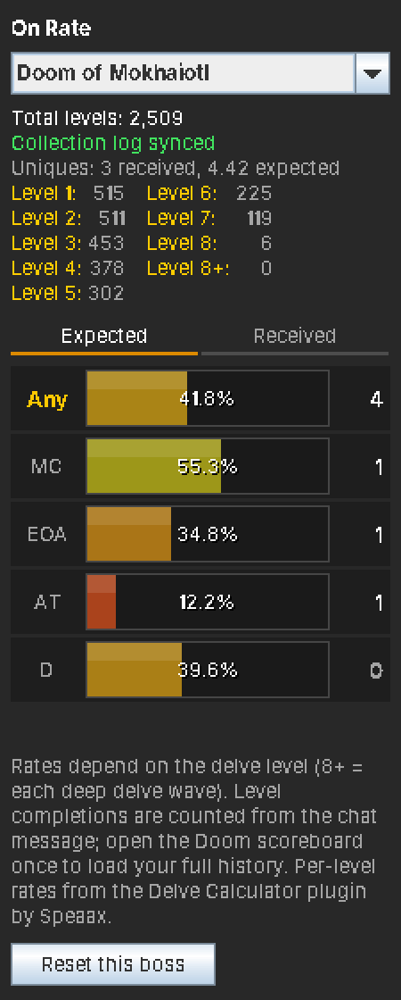
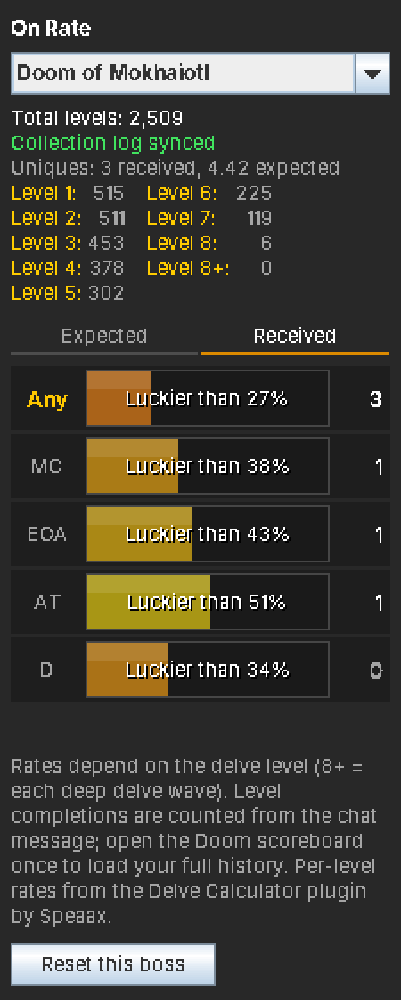
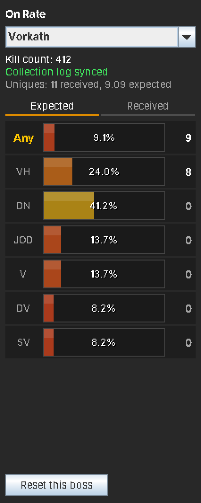
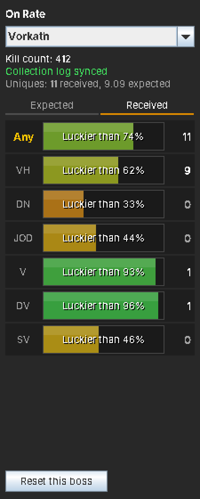

# On Rate

**Are you on rate?** On Rate is a RuneLite plugin that shows, for every boss, how many uniques you *should* have by now compared with how many you actually got. One glance tells you whether you're spooned, dry, or right on rate.

> **Built on the idea of the [Delve Calculator](https://github.com/Speaax/Delve-calculator) by Speaax.**
> The Delve Calculator shows expected vs received drops for Doom of Mokhaiotl, and On Rate exists because that panel was so good that I wanted it for every boss. The layout, the Expected/Received split and the per-level Doom rates all come from Speaax's work. If you mainly do Doom, go and install the Delve Calculator too: it has Doom-specific features this plugin doesn't. See [Credits](#credits).

## Features

- **Expected vs received drops for 53 bosses and all three raids**, including Doom of Mokhaiotl with its per-delve-level rates.
- **Works out of the box.** Your kill count updates after every kill, and new drops are picked up automatically.
- **Imports your history** from your collection log, so you don't start from zero.
- **Luck percentile:** see how your drops compare with every other player at the same kill count.
- **An "Any" row** that combines all of a boss's uniques.
- **Hover any row** for the drop rate, your chance of having it by now, and how many kills give a 50% or 90% chance.
- **Saved per account.** Group Ironman, main and alts each keep their own numbers.

## Installing

On Rate has been submitted to the Plugin Hub and is waiting for review. Once it's approved:

1. Open RuneLite and click the **Plugin Hub** button at the bottom of the Configuration (wrench) panel.
2. Search for **On Rate** and click **Install**.
3. A new icon with three coloured bars appears in the sidebar. Click it to open the panel.

## Getting started

1. **Keep the Loot Tracker plugin on.** It's on by default, and On Rate reads new drops from it.
2. **Open your collection log** and click through the pages of the bosses you care about. On Rate reads your kill count and what you've already received from each page. The panel shows *Collection log synced* once a boss is done.
3. **Doom of Mokhaiotl players:** open the Doom scoreboard once. It loads your completions for every delve level.
4. **Go kill something.** The panel switches to the boss you just killed and updates by itself.

## Reading the panel

Pick a boss from the dropdown, or let the panel follow your kills.

### Expected tab

Works exactly like the Delve Calculator:

- The **number on the right** is how many of that item you should have by now.
- The **bar** is your progress towards the next one.

For example, **"Any · 41.8% · 4"** means you should have had 4.418 uniques by now: four whole drops, and 41.8% of the way to a fifth.

### Received tab

- The **number on the right** is how many you actually got.
- The **bar** shows how lucky that is: *"Luckier than 74%"* means 74% of players with the same kill count have fewer drops than you. 50% is exactly average.
- **Colours:** red is dry, yellow is about average, green is spooned.

## Supported bosses

Abyssal Sire, Alchemical Hydra, Amoxliatl, Araxxor, Artio, Barrows, Callisto, Calvar'ion, Cerberus, Chambers of Xeric, Chaos Elemental, Chaos Fanatic, Commander Zilyana, Corporeal Beast, Corrupted Gauntlet, Crazy Archaeologist, Dagannoth Prime, Dagannoth Rex, Dagannoth Supreme, Doom of Mokhaiotl, Duke Sucellus, Gauntlet, General Graardor, Grotesque Guardians, Hespori, Hueycoatl, K'ril Tsutsaroth, Kalphite Queen, King Black Dragon, Kraken, Kree'arra, Nex, Phantom Muspah, Phosani's Nightmare, Royal Titans, Sarachnis, Scorpia, Scurrius, Shellbane Gryphon, Skotizo, Spindel, The Leviathan, The Whisperer, Theatre of Blood, Thermonuclear Smoke Devil, Tombs of Amascut, Tormented Demons, TzKal-Zuk, TzTok-Jad, Vardorvis, Venenatis, Vet'ion, Vorkath, Yama, Zalcano and Zulrah.

## Settings

Open the settings with the cog next to **On Rate** in the Configuration panel.

- **Follow last kill:** switch the panel to the boss you just killed. On by default.
- **Raid purple chances:** the chance of a unique per raid depends on your points and team, so set your own:
  - **Chambers of Xeric:** every 8,676 of your personal points is 1%. The default 3.5% matches about 30,000 points.
  - **Theatre of Blood:** a team gets a purple about once every 9.1 raids. Divide 11% by your team size; the default is 2.7%, for a 4-man.
  - **Tombs of Amascut:** depends on raid level and points. The ToA page on the OSRS Wiki has a calculator.

## Good to know

- **Rates are solo / full-contribution base rates**, without diary or Combat Achievement boosts. In team content (Nex, Hueycoatl, Royal Titans, Yama duos, Corporeal Beast with others), your real chance is lower than shown.
- **Items several bosses drop** have one collection log total for all of them, so On Rate can't tell which boss each copy came from. They're only counted from drops it sees itself. This covers the dragon pickaxe, godsword shards, Virtus, chromium ingots, draconic visage, uncut onyx, dragon axe and dragon chainbody, plus every drop from the split wilderness bosses (Callisto and Artio, and so on).
- **Gauntlet loot** goes to a chest the Loot Tracker doesn't see. On Rate notices first-time drops through the collection log message, but not repeat seeds.
- **Pets** are counted from the "funny feeling" message right after a kill.
- **Not covered yet:** Fortis Colosseum (its rates depend on the wave) and the team version of The Nightmare.
- **Made a mistake?** The **Reset this boss** button clears that boss. Open its collection log page again to re-sync.

### Using your own rates

All rates live in one file, [`bosses.json`](src/main/resources/com/expecteddrops/bosses.json). To change them without rebuilding the plugin:

1. Copy the file to `.runelite/on-rate/bosses.json` in your user folder.
2. Edit the copy.
3. Turn the plugin off and on again.

## Credits

**[Delve Calculator](https://github.com/Speaax/Delve-calculator) by [Speaax](https://github.com/Speaax)** is the reason this plugin exists. On Rate takes from it:

- **The idea and the look:** an Expected tab with whole drops plus a bar towards the next one, and a Received tab that shows your luck.
- **All Doom of Mokhaiotl rates per delve level**, including the deep delve (8+) rates.
- **How to count Doom completions** from the "Delve level" chat message and the Doom scoreboard.
- **The per-level table** at the top of the Doom view.

On Rate shows the same expected numbers as the Delve Calculator for Doom; the plugin's tests check this against its numbers. The Delve Calculator is released under the BSD 2-Clause licence. If you like this plugin, please give the Delve Calculator a star too, and use it for Doom: it has extras like session tracking, auto-opening in the Delve area and separate tracking per game mode.

**Thanks also to:**

- **The [Old School RuneScape Wiki](https://oldschool.runescape.wiki)** for the drop rates of every other boss.
- **The RuneLite developers** for the client and the Loot Tracker plugin that On Rate builds on.

## For developers

To run On Rate from source, you need Java 11 or newer and IntelliJ IDEA:

1. Open this folder in IntelliJ.
2. In the Gradle tool window, run **Tasks → application → run**. This starts RuneLite in developer mode with the plugin loaded.

To log in with a Jagex account in that window, start RuneLite once through the Jagex Launcher with `--insecure-write-credentials` set in *RuneLite (configure) → Client arguments*.

`gradlew test` runs the maths and tracking tests.

## Licence

BSD 2-Clause. See [LICENSE](LICENSE).
