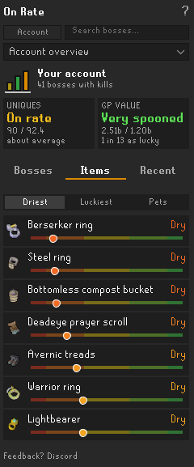

# On Rate

**Are you on rate?** On Rate is a RuneLite plugin that shows, for every boss, how many uniques you *should* have by now compared with how many you actually got. One glance tells you whether you're spooned, dry, or right on rate.

> Built on the idea of the [Delve Calculator](https://github.com/Speaax/Delve-calculator) by Speaax, which does this for Doom of Mokhaiotl. If you mainly do Doom, install it too. See [Credits](#credits).

## Features

- **Every boss and raid** in the Bosses and Raids tabs of the collection log, over 50 in total, including Doom of Mokhaiotl per delve level.
- **Two verdicts per boss**, from *Very dry* to *Very spooned*: how many uniques you got, and what they're worth in GP. Plus how you compare with other players at the same kill count.
- **Account overview:** all your bosses added up, your driest and luckiest items and pets, and what you killed and got today and this week.
- **Hover any item** for its drop rate, your dry streak, how far past the drop rate you are and how many players have fewer or more.
- **History** per boss: the kills On Rate saw and what they dropped.
- **Uses your raid points** for each raid's purple chance, and **counts your team** at Nex, Yama, the Hueycoatl and Corp.
- **Imports your past drops** from the collection log, then updates by itself after every kill.
- **Quiet:** no web requests and no files. Everything is saved in RuneLite's own settings, per account.

## Getting started

1. Install **On Rate** from the Plugin Hub. The panel opens with a short welcome guide.
2. **Open your collection log** and click the pages of the bosses you do. That loads your kill count and past drops. The orange line at the top of the panel lists the bosses you killed that aren't loaded yet. Until a boss is loaded, its page says *Not synced* instead of a verdict.
3. **Go kill something.** The panel follows your kills. Keep the Loot Tracker plugin on: On Rate reads new drops from it.
4. **Check the settings:** pick a **Luck view** you like (bars, a table, rings or a gauge), and change **Team bosses** if you solo Royal Titans or Yama (both count as duo by default).

The **?** at the top of the panel explains what you're looking at.

## Good to know

- Rates are **solo base rates** from the [OSRS Wiki](https://oldschool.runescape.wiki), without diary, Combat Achievement or Slayer boosts. Where each one comes from: [docs/RATES.md](docs/RATES.md).
- Items several bosses drop (dragon pickaxe, godsword shards, Virtus, onyx...) are judged on all those bosses' kills together, under **Shared with other bosses** on each boss page.
- Pets and Royal Titans prayer scrolls count once, like in the collection log.
- Raids without points (everything from before you installed On Rate) use an average purple chance, which you can change under **Raid purple chances** in the settings.
- **Not covered:** Fortis Colosseum, Tempoross, Wintertodt, team Nightmare and the collection log's Other tab.

Every part of the panel, every setting and every assumption is explained in [docs/HOW-IT-WORKS.md](docs/HOW-IT-WORKS.md). What changed in each version is in [CHANGELOG.md](CHANGELOG.md).

## Feedback

Found a bug or a wrong drop rate, or have an idea? Join the **[On Rate Discord](https://discord.gg/gh9fx6T9zn)**. For a wrong rate, please include the boss and a link to the wiki page; for a bug, a screenshot helps a lot.

## Credits

- **[Delve Calculator](https://github.com/Speaax/Delve-calculator) by [Speaax](https://github.com/Speaax)** (BSD 2-Clause): the idea and the look (an Expected and a Received view), all Doom of Mokhaiotl rates per delve level, and how to count Doom completions. On Rate's tests check its Doom numbers against the Delve Calculator's.
- **[Raid Data Tracker](https://github.com/Raitab/raid-data-tracker) by [Raitab](https://github.com/Raitab)**: how On Rate reads raid points (Chambers of Xeric points, the Tombs of Amascut points estimate, the Theatre of Blood end-of-raid board). That code is used under the BSD 2-Clause licence, copyright **CasvM**, **LlemonDuck** and **TheStonedTurtle**; the Tombs of Amascut points estimate was written by **LlemonDuck** and **TheStonedTurtle** for the Tombs of Amascut plugin. The files based on it keep their copyright notices, and the licence is in [licenses/](licenses/).
- **The [OSRS Wiki](https://oldschool.runescape.wiki)** for the drop rates, **the RuneLite developers** for the client and the Loot Tracker, and **the Drop Luck Ledger and Spoon Meter plugins** for ideas (no code was taken from them).

## For developers

Open this folder in IntelliJ IDEA (Java 11 or newer) and run **Tasks → application → run** in the Gradle tool window to start RuneLite with the plugin. `gradlew test` runs the tests. Every upload to GitHub is built and tested automatically: a green tick next to a commit means it works.

## Licence

BSD 2-Clause. See [LICENSE](LICENSE).
