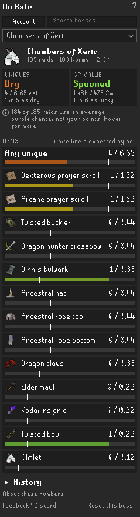
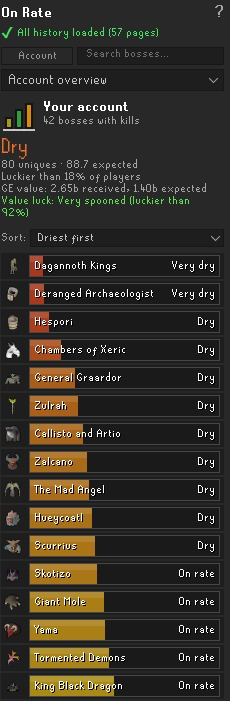
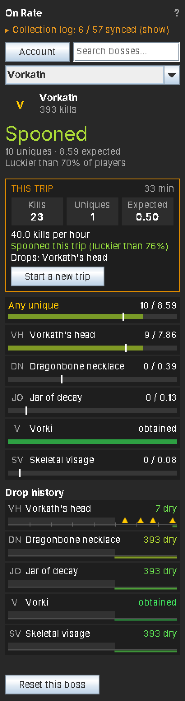
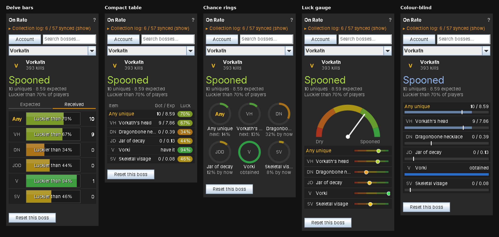

# On Rate

**Are you on rate?** On Rate is a RuneLite plugin that shows, for every boss, how many uniques you *should* have by now compared with how many you actually got. One glance tells you whether you're spooned, dry, or right on rate.

> **Built on the idea of the [Delve Calculator](https://github.com/Speaax/Delve-calculator) by Speaax.**
> The Delve Calculator shows expected vs received drops for Doom of Mokhaiotl, and On Rate exists because that panel was so good that I wanted it for every boss. The layout, the Expected/Received split and the per-level Doom rates all come from Speaax's work. If you mainly do Doom, go and install the Delve Calculator too: it has Doom-specific features this plugin doesn't. See [Credits](#credits).

## Features

- **Expected vs received drops for 59 bosses and all three raids**, including Doom of Mokhaiotl with its per-delve-level rates.
- **Works out of the box.** Your kill count updates after every kill, and new drops are picked up automatically.
- **Imports your history** from your collection log, so you don't start from zero.
- **Luck percentile:** see how your drops compare with every other player at the same kill count.
- **An "Any unique" row** that combines all of a boss's uniques.
- **A verdict for every boss**, from "Very dry" to "Very spooned", in big letters at the top.
- **A clean layout:** one bar per item shows what you got against where you should be. Prefer another look? Choose the Delve Calculator's bars, a compact table, chance rings or a luck gauge.
- **Account overview:** every boss added up into one total, with a row per boss that you can sort (driest first, luckiest first...), plus **GE value luck**, so two twisted bows count for more than a pile of cheap drops.
- **Optional extras:** a luck graph, a "this trip" card, drop history timelines, an in-game overlay and colour-blind colours.
- **Uses your raid points:** read from the game in Chambers of Xeric and estimated from your damage in Tombs of Amascut, so each raid gets its own purple chance. Based on [Raid Data Tracker](https://github.com/Raitab/raid-data-tracker) (see [Credits](#credits)).
- **Search box:** type "vork", "cox" or "kril" to jump to a boss.
- **Dry streaks:** hover any item to see how many kills since your last copy, and how many times the drop rate that is.
- **Chat messages:** a short line when a unique drops ("Vorkath's head after 312 kills (2.4x the rate).") and when you pass 1x, 2x, 3x, 5x or 10x the drop rate dry. Both can be turned off.
- **Hover any row** for the drop rate, your chance of having it by now, and how many kills give a 50% or 90% chance.
- **Guided setup:** a welcome guide, a checklist of the collection log pages you still need to open, and a chat reminder when you kill a boss whose history isn't loaded yet.
- **Saved per account.** Group Ironman, main and alts each keep their own numbers.

## Installing

On Rate has been submitted to the Plugin Hub and is waiting for review. Once it's approved:

1. Open RuneLite and click the **Plugin Hub** button at the bottom of the Configuration (wrench) panel.
2. Search for **On Rate** and click **Install**.
3. A new icon with three coloured bars appears in the sidebar. Click it to open the panel.

## Getting started

The first time you open the panel, a short welcome guide walks you through this.

1. **Keep the Loot Tracker plugin on.** It's on by default, and On Rate reads new drops from it.
2. **Open your collection log** and click through the pages of the bosses you care about. On Rate reads your kill count and what you've already received from each page. The **"Collection log: 12 / 46 synced"** line at the top of the panel shows your progress. Click it to see which pages are left, and click a page name to view that boss.
3. **Doom of Mokhaiotl players:** open the Doom scoreboard once. It loads your completions for every delve level.
4. **Go kill something.** The panel switches to the boss you just killed and updates by itself. If that boss's history isn't loaded yet, On Rate tells you in chat which page to open (once per session).

## Reading the panel

Pick a boss from the dropdown, or let the panel follow your kills. To find a boss quickly, type in the search box above the dropdown: part of the name ("vork", "kril") or the usual short name ("cox", "tob", "toa", "dk"). Enter opens the first match. The **Account** button next to it always takes you back to the account overview. The **?** at the top right explains what you're looking at.

### Boss page

- At the top: the boss, your kill count and the **verdict** in big letters: Very dry, Dry, On rate, Spooned or Very spooned. Under it, how many uniques you got against how many you should have, and how you compare with other players at the same kill count ("luckier than 70%" means 70% of them have fewer drops than you).
- Then one row per item, with **Any unique** first. The bar's fill is how many you got; the **white line** is how many you should have by now. Behind the line is dry, past it is spooned.
- **Hover an item** for its drop rate, your chance of having it by now, how many kills give a 50% or 90% chance, and your **dry streak**: kills since your last copy and how many times the drop rate that is. If your last copy dropped before you installed On Rate, it says "at least".

### Account overview

What the panel opens on. It adds up every boss you have kills at:

- The **verdict** at the top is your whole account.
- **GE value** compares the Grand Exchange value of what you got with what you should have had, and gives its own verdict. An account that's dry on the number of drops but hit two twisted bows shows up as spooned here. Prices come from RuneLite's own price list, so On Rate makes no web requests. Untradeable items like pets and jars count for the number of uniques but as 0 GP for value. You can hide it in the settings.
- One row per boss with its verdict. Use **Sort** to put the most expected, driest, luckiest, most killed or alphabetical first. Click a boss to open it, or hover it to see its driest item.

### Other views

Prefer something else than the bars? Pick a **Luck view** in the settings:

- **Target bars** (default): described above.
- **Bars with tabs (Delve Calculator):** the classic Expected and Received tabs. On *Expected* the number is how many you should have and the bar your progress to the next one ("Any · 41.8% · 4" means 4.418 uniques by now); on *Received* the number is how many you got and the bar how lucky that is.
- **Compact table:** one line per item: got / expected and a luck percentage.
- **Chance rings:** each ring fills up as your chance of having the item grows. Once you have it, the ring shows your chance of the next one by now.
- **Luck gauge:** a speedometer from dry to spooned, with every item (or boss) as a dot on the same scale.

### Extras

All off by default; turn them on in the settings under **Display**.

- **Luck graph:** your account's luck over time, one point per day you play, in the account overview. On Rate saves a point every day even while the graph is hidden, so it has data when you turn it on.
- **This trip card:** kills, uniques and expected for your current trip on the boss page, plus kills per hour and the drops you got. A trip ends when you kill another boss, after 30 minutes without a kill, or with the *Start a new trip* button.
- **Drop history:** a timeline per item with the kills your drops came at, the average spacing and your current dry streak. Only drops On Rate saw itself are known.
- **In-game overlay:** a small box on the game screen while you kill a boss: verdict, uniques, your driest item and the trip.
- **Colour-blind colours:** orange to blue instead of red to green.

## Supported bosses

Abyssal Sire, Alchemical Hydra, Amoxliatl, Araxxor, Barrows, Brutus, Bryophyta, Callisto and Artio, Cerberus, Chambers of Xeric, Chaos Fanatic, Commander Zilyana, Corporeal Beast, Crazy Archaeologist, Dagannoth Kings, Deranged Archaeologist, Doom of Mokhaiotl, Duke Sucellus, General Graardor, Giant Mole, Grotesque Guardians, Hespori, Hueycoatl, K'ril Tsutsaroth, Kalphite Queen, King Black Dragon, Kraken, Kree'arra, Moons of Peril, Nex, Obor, Phantom Muspah, Phosani's Nightmare, Royal Titans, Sarachnis, Scorpia, Scurrius, Shellbane Gryphon, Skotizo, The Gauntlet, The Leviathan, The Mad Angel, The Whisperer, Theatre of Blood, Thermonuclear Smoke Devil, Tombs of Amascut, Tormented Demons, TzKal-Zuk, TzTok-Jad, Vardorvis, Venenatis and Spindel, Vet'ion and Calvar'ion, Vorkath, Yama, Zalcano and Zulrah.

Bosses that share a collection log page are shown together, just like in the log: **Dagannoth Kings**, **Callisto and Artio**, **Vet'ion and Calvar'ion**, **Venenatis and Spindel**, and **The Gauntlet** (normal and Corrupted). Each boss on the page keeps its own kill count and drop rates.

**Chaos Elemental** isn't tracked: its only uniques are the dragon pickaxe and a pet it shares with Chaos Fanatic, which are both left out (see [Good to know](#good-to-know)).

**Barrows** assumes you kill all six brothers before every chest, and **Moons of Peril** assumes you defeat all three moons before opening the Lunar Chest.

## Settings

Open the settings with the cog next to **On Rate** in the Configuration panel.

- **Follow last kill:** switch the panel to the boss you just killed. On by default.
- **Show welcome guide:** show the getting-started steps at the top of the panel. *Got it* turns this off; turn it back on here.
- **Sync reminders:** the chat reminder after killing a boss that isn't synced yet. On by default.
- **Drop messages:** a chat line when you get a unique, saying how many kills it took. On by default.
- **Dry milestone messages:** a chat line when you pass 1x, 2x, 3x, 5x or 10x the drop rate dry on an item. On by default.
- **Luck view:** how your luck is shown (see [Other views](#other-views)).
- **GE value**, **Luck graph**, **This trip card**, **Drop history**, **In-game overlay** and **Colour-blind colours**: see [Extras](#extras). Only GE value is on by default.
- **Royal Titans:** kills count as **duo** kills unless you change it to **Solo** or **Some of each**. With *Some of each*, also enter how many of your kills were solo; the rest count as duo. In a duo you get about half the uniques of a solo kill, while the pet chance stays the same.
- **Use raid points:** at the end of each raid, On Rate saves your points with the completion and works out that raid's purple chance from them. On by default. How it gets the points:
  - **Chambers of Xeric:** read straight from the game when "Congratulations - your raid is complete!" appears: your points, the team's points and the team size.
  - **Tombs of Amascut:** the game never shows your points, so On Rate estimates them the way [Raid Data Tracker](https://github.com/Raitab/raid-data-tracker) and the Tombs of Amascut plugin do: your own hits times a points factor per monster, rooms capped at 20,000 (Crondis 10,000), 64,000 in total, Wardens phase 2 stops counting once it has been downed more than three times, fixed points for puzzle rooms, 300 per player for MVP items, and minus 20% (at least 1,000) per death. The raid level is read from the game. In a team On Rate only knows your own points; if you have the **Tombs of Amascut** plugin installed, its party total is used instead. On Rate needs to see the raid start, so a raid you were already in when you turned it on uses the setting.
  - **Theatre of Blood:** there are no points to read. On Rate saves the team size, your deaths and whether you were MVP from the board at the end, and splits the team purple chance from the settings over that raid's real team size.

  The chance is worked out with the OSRS Wiki's formulas. **CoX:** every 8,676 team points is 1% for a unique, one roll is capped at 570,000 points (65.7%) and more points roll for another unique; you get a unique with your share of the points. **ToA:** 1% per 10,500 - 20 x raid level team points (the raid level counts fully up to 310, a third from 310 to 430 and a sixth above that), capped at 55%; at low raid levels some uniques are rare: below raid level 50 for Osmumten's fang and Lightbearer, below 150 for the shadow, ward and Masori. When the chest picks one of those, you only get it 1 time in 50; otherwise you get normal loot instead.

  Raids done before this update and raids synced from the collection log use the percentages below (ToB with the ToB team size setting). The raid's page says how many raids used your points. Over time, more and more of your raids use their own points.
- **ToB team size:** how many players you usually do Theatre of Blood with (4 by default). Your share of the team's purples is 1 / team size. Raids where On Rate read the end-of-raid board use their real team size.
- **Raid purple chances:** your chance of a unique per raid depends on your points, team and mode, so every mode has its own setting. The panel counts each mode's completions separately.

  | Raid | Mode | Default | How to work it out |
  |---|---|---|---|
  | Chambers of Xeric | Normal | 3.5% | Every 8,676 of your personal points is 1% (30,000 points is about 3.5%) |
  | Chambers of Xeric | Challenge Mode | 6.6% | Same formula; a Challenge Mode raid is usually 6.3 to 6.9%. It uses its own unique table (prayer scrolls are rarer) |
  | Theatre of Blood | Normal | 11% for the team | A team gets a purple about 1 in 9.1 raids. On Rate splits it over the **ToB team size** setting (4 by default), or over the real team size when it read the end-of-raid board |
  | Theatre of Blood | Hard Mode | 13% for the team | About 1 in 7.7 raids, split the same way |
  | Theatre of Blood | Entry Mode | 0% | Entry Mode has no uniques |
  | Tombs of Amascut | Entry Mode | 0.75% | At low raid levels most rolled uniques turn into other loot |
  | Tombs of Amascut | Normal | 2.5% | Depends on raid level and points; the OSRS Wiki has a calculator |
  | Tombs of Amascut | Expert Mode | 5% | Same as above |

## Good to know

- **Rates are solo / full-contribution base rates**, without diary or Combat Achievement boosts. In team content (Nex, Hueycoatl, Yama duos, Corporeal Beast with others), your real chance is lower than shown. Royal Titans counts as duo kills by default and has its own solo/duo setting.
- **Items several bosses drop are left out completely**: the dragon pickaxe, godsword shards, Virtus, chromium ingots, draconic visage, uncut onyx, dragon chainbody, dragon 2h sword and the Chaos Elemental pet. The collection log has one total for all their bosses, so On Rate can't tell which boss each copy came from; counting them would add expected drops without the matching received ones and make accounts look drier than they are.
- **Gauntlet loot** goes to a chest the Loot Tracker doesn't see. On Rate notices new items through the collection log message; open The Gauntlet's collection log page after a session to update repeat seeds.
- **Pets** are counted from the "funny feeling" message right after a kill. Like the collection log, On Rate counts a pet once: for luck, what matters is whether you have it by now, not how many duplicates you might have rolled. Royal Titans prayer scrolls work the same way, because they stop dropping once read.
- **Not covered yet:** Fortis Colosseum (its rates depend on the wave) and the team version of The Nightmare.
- **Chest bosses:** Obor's and Bryophyta's uniques come from their chests, which the Loot Tracker doesn't see. New items show up through the collection log message; open their collection log pages to update repeat drops.
- **No files:** On Rate only uses the rates built into the plugin and saves your progress in RuneLite's own settings, so it doesn't read or write any files on your computer.
- **Made a mistake?** The **Reset this boss** button clears that boss. Open its collection log page again to re-sync.

## Credits

**[Delve Calculator](https://github.com/Speaax/Delve-calculator) by [Speaax](https://github.com/Speaax)** is the reason this plugin exists. On Rate takes from it:

- **The idea and the look:** an Expected tab with whole drops plus a bar towards the next one, and a Received tab that shows your luck.
- **All Doom of Mokhaiotl rates per delve level**, including the deep delve (8+) rates.
- **How to count Doom completions** from the "Delve level" chat message and the Doom scoreboard.
- **The per-level table** at the top of the Doom view.

On Rate shows the same expected numbers as the Delve Calculator for Doom; the plugin's tests check this against its numbers. The Delve Calculator is released under the BSD 2-Clause licence. If you like this plugin, please give the Delve Calculator a star too, and use it for Doom: it has extras like session tracking, auto-opening in the Delve area and separate tracking per game mode.

**[Raid Data Tracker](https://github.com/Raitab/raid-data-tracker) by [Raitab](https://github.com/Raitab)** for how On Rate reads raid points: the Chambers of Xeric points and team size, the Tombs of Amascut points estimate, the Tombs of Amascut plugin's party points message and the Theatre of Blood end-of-raid board. That code is used under the BSD 2-Clause licence, copyright **CasvM**, **LlemonDuck** and **TheStonedTurtle**; the Tombs of Amascut points estimate was written by **LlemonDuck** and **TheStonedTurtle** for the Tombs of Amascut plugin. The files based on it keep their copyright notices, and the licence is in [licenses/](licenses/).

**Thanks also to:**

- **The [Old School RuneScape Wiki](https://oldschool.runescape.wiki)** for the drop rates of every other boss.
- **The RuneLite developers** for the client and the Loot Tracker plugin that On Rate builds on.

## For developers

To run On Rate from source, you need Java 11 or newer and IntelliJ IDEA:

1. Open this folder in IntelliJ.
2. In the Gradle tool window, run **Tasks → application → run**. This starts RuneLite in developer mode with the plugin loaded.

To log in with a Jagex account in that window, start RuneLite once through the Jagex Launcher with `--insecure-write-credentials` set in *RuneLite (configure) → Client arguments*.

`gradlew test` runs the maths and tracking tests.

## Licence

BSD 2-Clause. See [LICENSE](LICENSE).
