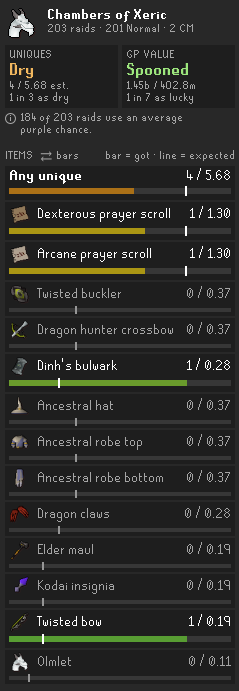
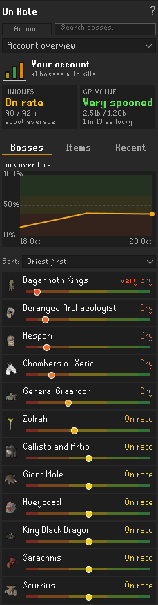
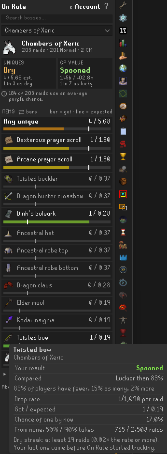

# On Rate

**Are you on rate?** On Rate is a RuneLite plugin that shows, for every boss and raid, how many uniques you *should* have by now at the drop rates and how many you actually got, with a plain verdict from *Very dry* to *Very spooned*.

**How to read it:** on each item, the bar is what you got and the white line is what you should have by now. On the Items tab each row also says *got / expected* (for example `0 / 2.60`): what you have against the average for a typical player at your kill count. That is an average, not drops you were owed. Figures like "luckier than 83% of players" come from the drop-rate maths for a typical player at your kill count, not from other players' accounts: On Rate has no player data.

> Built on the idea of the [Delve Calculator](https://github.com/Speaax/Delve-calculator) by Speaax, which does this for Doom of Mokhaiotl. If you mainly do Doom, install it too. See [Credits](#credits).

## Before you start

- **Open the collection log page** of each boss you do. Until you do, that boss says *Not synced* instead of a verdict.
- **Keep the Loot Tracker plugin on.** On Rate reads new drops from it.
- **Rates are solo base rates** from the OSRS Wiki, without diary, Combat Achievement or Slayer boosts, so your numbers can look drier than a boosted rate would.

## Features

- **Over 50 bosses and raids** from the Bosses and Raids tabs of the collection log, including Doom of Mokhaiotl per delve level (Fortis Colosseum, Tempoross and Wintertodt arrive with the next update; a few things are left out: see *Not covered* below).
- **Two verdicts per boss**, from *Very dry* to *Very spooned*: how many uniques you got, and what they're worth in GP. Plus how common your result is among players at the same kill count, worked out from the drop rates.
- **Account overview:** all your bosses added up, up to 15 of your driest and 15 of your luckiest items, each with got / expected, your pets, and what you killed and got today and this week.
- **Hover any item** for its drop rate, your dry streak, how far past the drop rate you are and how many players at your kill count would have fewer or more (worked out from the drop rates).
- **History** per boss: the kills On Rate saw and what they dropped.
- **Uses your raid points** for each raid's purple chance, and **counts your team** at Nex, Yama, the Hueycoatl, Corp and Zalcano.
- **Imports your past drops** from the collection log, then updates by itself after every kill.
- **Quiet:** no web requests and no files. Everything is saved in RuneLite's own settings, per account.

## Getting started

1. Install **On Rate** from the Plugin Hub. The panel opens with a short welcome guide.
2. **Open your collection log** and click the pages of the bosses you do. That loads your kill count and past drops. The line at the top of the panel lists the bosses you killed that aren't loaded yet. Until a boss is loaded, its page says *Not synced* instead of a verdict.
3. **Go kill something.** The panel follows your kills. Keep the Loot Tracker plugin on: On Rate reads new drops from it.
4. **Check the settings:** change **Team bosses** if you solo Royal Titans or Yama (both count as duo by default). For another view (bars, a table, rings or a gauge), click **⇄** next to **ITEMS** in the panel.

The **?** at the top of the panel explains what you're looking at.

## Good to know

- Rates are **solo base rates** from the [OSRS Wiki](https://oldschool.runescape.wiki), without diary, Combat Achievement or Slayer boosts. Where each one comes from: [docs/RATES.md](docs/RATES.md).
- Items several bosses drop (dragon pickaxe, godsword shards, Virtus, onyx...) are judged on all those bosses' kills together, under **Shared with other bosses** on each boss page.
- Pets and Royal Titans prayer scrolls count once, like in the collection log.
- Raids without points (everything from before you installed On Rate) use an average purple chance, which you can change under **Raid purple chances** in the settings.
- **Not covered:** team Nightmare and the collection log's Other tab.

Every part of the panel, every setting and every assumption is explained in [docs/HOW-IT-WORKS.md](docs/HOW-IT-WORKS.md). What changed in each version is in [CHANGELOG.md](CHANGELOG.md).

## If something looks off

- **A boss says *Not synced*:** open that boss's page in your collection log. The line at the top of the panel lists the bosses you killed that aren't loaded yet.
- **A boss says *Too early* (from the next update):** less than half a unique is expected so far, and a few kills can't tell dry from lucky. It becomes a verdict as kills add up.
- **Everything looks dry:** the rates are solo base rates without boosts (see *Before you start*). Raids from before you installed On Rate use an average purple chance, which you can change in the settings.
- **Nex, Yama, Royal Titans or other team bosses look wrong:** check the **Team bosses** settings. Royal Titans and Yama count as duo by default.
- **A drop rate looks wrong:** see Feedback below.
- **Made a mistake?** The small **Reset this boss…** link at the bottom of a boss page clears that boss. Open its collection log page again to re-sync.

## Feedback

Found a bug or a wrong drop rate, or have an idea? You can [open an issue on GitHub](https://github.com/Pyrocrad/On-Rate/issues/new/choose) (it asks for the details that help) or join the **[On Rate Discord](https://discord.gg/gh9fx6T9zn)**. For a wrong rate, please include the boss, the item and a link to the wiki page; for a bug, a screenshot helps a lot.

## Credits

- **[Delve Calculator](https://github.com/Speaax/Delve-calculator) by [Speaax](https://github.com/Speaax)** (BSD 2-Clause): the idea and the look (an Expected and a Received view), all Doom of Mokhaiotl rates per delve level, and how to count Doom completions. On Rate's tests check its Doom numbers against the Delve Calculator's.
- **[Raid Data Tracker](https://github.com/Raitab/raid-data-tracker) by [Raitab](https://github.com/Raitab)**: how On Rate reads raid points (Chambers of Xeric points, the Tombs of Amascut points estimate, the Theatre of Blood end-of-raid board). That code is used under the BSD 2-Clause licence, copyright **CasvM**, **LlemonDuck** and **TheStonedTurtle**; the Tombs of Amascut points estimate was written by **LlemonDuck** and **TheStonedTurtle** for the Tombs of Amascut plugin. The files based on it keep their copyright notices, and the licence is in [licenses/](licenses/).
- **The [OSRS Wiki](https://oldschool.runescape.wiki)** for the drop rates, **the RuneLite developers** for the client and the Loot Tracker, and **the Drop Luck Ledger and Spoon Meter plugins** for ideas (no code was taken from them).

## For developers

Open this folder in IntelliJ IDEA (Java 11 or newer) and run **Tasks → application → run** in the Gradle tool window to start RuneLite with the plugin. `gradlew test` runs the tests. Every upload to GitHub is built and tested automatically: a green tick next to a commit means it builds and passes its tests. To correct a drop rate, see *Checking again* in [docs/RATES.md](docs/RATES.md).

## Licence

BSD 2-Clause. See [LICENSE](LICENSE).
