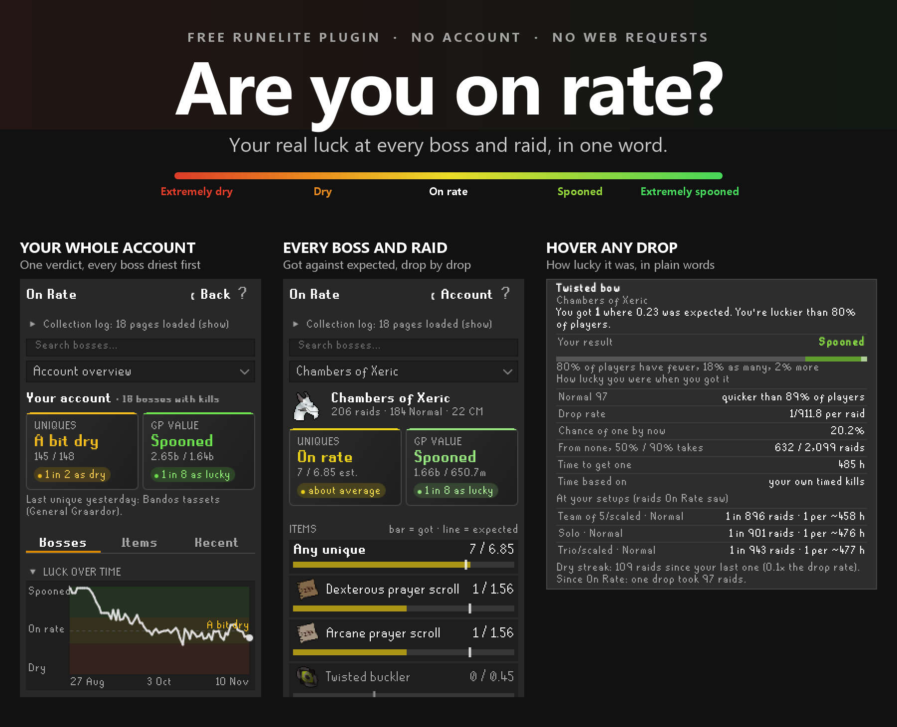
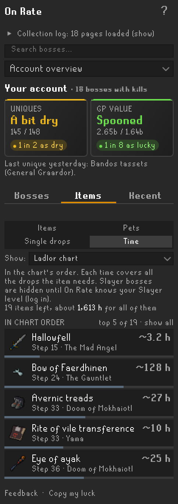
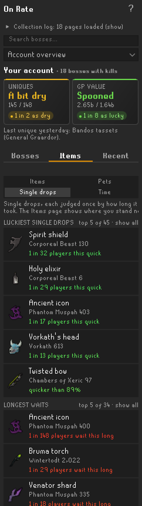
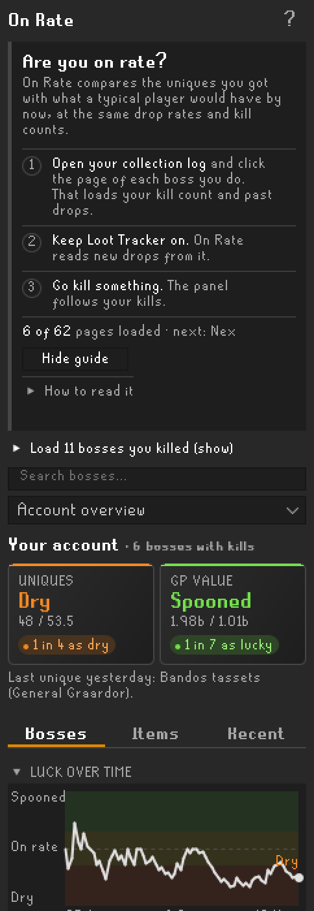
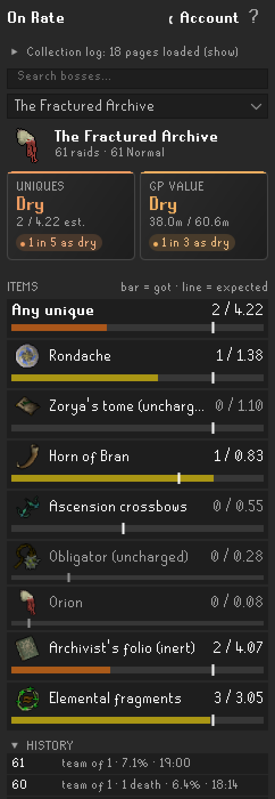
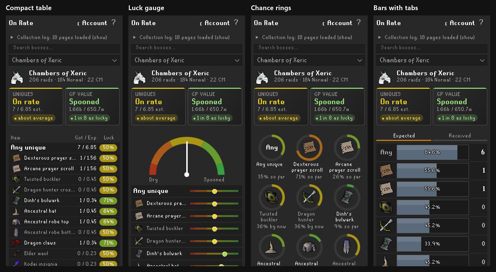

## Install it from the RuneLite Plugin Hub

**Open the Plugin Hub in RuneLite, search `On Rate`, click Install.**

Free · no account · no web requests · [Questions? Join the Discord](https://discord.gg/gh9fx6T9zn)

## What you get

Every boss has a drop rate and you have a kill count. On Rate does the sum for you: how many uniques you *should* have by now, how many you *actually* have, and a plain verdict from *Extremely dry* to *Extremely spooned*, at every boss and raid you do.

- **One verdict per boss, two ways:** how many uniques you got, and what they are worth in GP. Two twisted bows can be dry on the count and spooned on the value, and you see both.
- **Your whole account on one screen:** every boss added up and sorted driest first, your driest and luckiest items, your pets, luck over time, and what you killed and got today and this week.
- **Share it:** one click on **Copy my luck** puts your verdicts on the clipboard as plain text, ready for Discord or Reddit. Nothing is sent anywhere.
- **Every item against what you should have by now:** the bar is what you got, the white line is what you should have.
- **How lucky each drop really was:** hover any item for its drop rate, your dry streak and how many players would have fewer or more. The **Single drops** view lists your luckiest drops and longest waits, each judged by how long it took against its drop rate.
- **History per boss:** the kills On Rate saw and what they dropped, and how long each kill or raid took (read from the game's own time message). The boss page shows your average time.
- **Your best way to raid:** raid pages show your purple chance and GP value an hour for each setup you did (team size, mode or raid level), your personal bests, and your points over your last 40 raids.
- **Live while you play:** a trip card for the boss you are killing (kills, uniques, expected, value per hour) and an optional in-game overlay. Raid purple chances use your own raid points, and at Nex, Yama, the Hueycoatl, Corp and Zalcano it counts your team.
- **Time to get what you're missing:** the **Time** page shows how long, on average, each item you don't have takes to get, including every step of the Ladlor chart. [How it works](docs/HOW-IT-WORKS.md#the-time-page).
- **Your past drops, imported:** it reads them from the collection log, then updates by itself after every kill.
- **Private:** no web requests. Everything is saved in RuneLite's own settings, per account. The only files it reads are Raid Data Tracker's (read only, never written).

<table>
<tr>
<td align="center" valign="top"> <b>See how long each missing item will take</b> the Ladlor chart, step by step</td>
<td align="center" valign="top"> <b>See your luckiest drops and longest waits</b> each judged against its drop rate</td>
</tr>
<tr>
<td align="center" valign="top"> <b>Know which log pages to open next</b> the welcome guide counts them off</td>
<td align="center" valign="top"> <b>Find your boss by name</b> The Fractured Archive, got against expected</td>
</tr>
</table>

The banner and every picture here show sample data: one made-up player, the same in each, not a real account.

**How to read it:** on each item, the bar is what you got and the white line is what you should have by now. On the Items tab each row also says *got / expected* (for example `0 / 2.60`): what you have against the average for a typical player at your kill count. That is an average, not drops you were owed.

## Does it cover the bosses I do?

Over 50 bosses and raids, from the Bosses and Raids tabs of the collection log, including Doom of Mokhaiotl per delve level (a few things are left out, see *Straight about the maths*). Type part of a name in the panel's search box to find yours. The full list is in [docs/HOW-IT-WORKS.md](docs/HOW-IT-WORKS.md#supported-bosses).

Newest bosses: The Fractured Archive, Fortis Colosseum, Tempoross, Wintertodt.

## Is setup easy?

No account and nothing to configure: install it, open your collection log, and kill something.

1. **Install On Rate** from the Plugin Hub. The panel opens with a short welcome guide.
2. **Open your collection log** and click the page of each boss you do. That loads your kill count and past drops, and the boss shows its verdict. Until then it says *Not synced*: a verdict without your past drops would say *dry* for the wrong reason, so On Rate waits. The top of the panel lists the bosses you killed that aren't loaded yet.
3. **Keep the Loot Tracker plugin on and go kill something.** On Rate reads new drops from it and the panel follows your kills.
4. **Optional:** in the settings, change **Team bosses** if you solo Royal Titans or Yama (both count as duo by default), or pick another **Item view**.

The **?** at the top of the panel explains what you're looking at.

## Straight about the maths

- **"Players" is the drop-rate maths, not real accounts.** Figures like "luckier than 83% of players" come from the drop rates for a typical player at your kill count. On Rate has no player data.
- **Rates are solo base rates** from the [OSRS Wiki](https://oldschool.runescape.wiki), without diary, Combat Achievement or Slayer boosts, so your numbers can look drier than a boosted rate would. Where each rate comes from: [docs/RATES.md](docs/RATES.md).
- **Every kill is its own roll.** Being dry doesn't make the next drop more likely, and being spooned doesn't make it less likely.
- **Not covered:** team Nightmare and the collection log's Other tab.

## Good to know

- Items several bosses drop (dragon pickaxe, godsword shards, Virtus, onyx...) are judged on all those bosses' kills together, under **Shared with other bosses** on each boss page. Know where yours came from? **Right-click one to judge it on each boss separately:** drops On Rate sees go to the boss that dropped them, and you say where the older ones came from (a visage from a regular dragon can count for no boss at all).
- **Drops from before On Rate:** On Rate only sees drops that happen while it runs, so older ones have no known wait. If you remember the kill count, right-click the item (one you have) on its boss page and choose **I got this at kill...** (or *raid*, *delve*...), then type the count. It is added to the boss's History without a date and your dry streak counts from it. Open **Items > Single drops** on the account overview to see how lucky or dry that single drop was. Your unique counts and expected don't change. With several copies it asks if this was your first one; on pages with several modes or bosses (Chambers normal or Challenge Mode, Callisto or Artio...) it asks which one first.
- Pets and Royal Titans prayer scrolls count once, like in the collection log.
- Raids without points (everything from before you installed On Rate) use an average purple chance, which you can change under **Raid purple chances** in the settings.
- If you also use the **Raid Data Tracker** plugin, On Rate can read your raids from it: their times, points, team size and raid level, so the raid pages use your whole raid history. See [docs/HOW-IT-WORKS.md](docs/HOW-IT-WORKS.md#the-time-page).

Every part of the panel, every setting and every assumption is explained in [docs/HOW-IT-WORKS.md](docs/HOW-IT-WORKS.md). What changed in each version is in [CHANGELOG.md](CHANGELOG.md).

## If something looks off

- **A boss says *Not synced*:** open that boss's page in your collection log. The line at the top of the panel lists the bosses you killed that aren't loaded yet.
- **A boss page says *Too early*:** less than half a unique is expected so far, and a few kills can't tell dry from lucky. It becomes a verdict as kills add up.
- **Everything looks dry:** the rates are solo base rates without boosts (see *Straight about the maths*). Raids from before you installed On Rate use an average purple chance, which you can change in the settings.
- **Nex, Yama, Royal Titans or other team bosses look wrong:** check the **Team bosses** settings. Royal Titans and Yama count as duo by default.
- **A drop rate looks wrong:** see Feedback below.
- **History or raids empty after an update?** If On Rate can't read part of its saved data, it loads everything it can still read and leaves only the damaged part out. That part is first kept as a copy in RuneLite's settings (under the same name plus `.corrupt`), so nothing is written over it. Please tell us on Discord (see Feedback below).
- **Made a mistake?** The small **Reset this boss…** link at the bottom of a boss page clears that boss. Opening its collection log page again brings back the kill count and item counts, but History, raid points, team sizes, streaks, gaps, drops added by hand, Doom levels and Colosseum claims are gone for good.

## Feedback

Found a bug or a wrong drop rate, or have an idea? Join the **[On Rate Discord](https://discord.gg/gh9fx6T9zn)** or [open an issue on GitHub](https://github.com/Pyrocrad/On-Rate/issues/new/choose) (it asks for the details that help). For a wrong rate, please include the boss, the item and a link to the wiki page; for a bug, a screenshot helps a lot. Want to fix a rate yourself? See [CONTRIBUTING.md](CONTRIBUTING.md).

<b>Prefer another look?</b> Four more item views

 Pick an **Item view** in the settings: bars (shown above), a compact table, a luck gauge, chance rings or bars with tabs.

## Credits

> Built on the idea of the [Delve Calculator](https://github.com/Speaax/Delve-calculator) by Speaax, which does this for Doom of Mokhaiotl. If you mainly do Doom, install it too.

- **[Delve Calculator](https://github.com/Speaax/Delve-calculator) by [Speaax](https://github.com/Speaax)** (BSD 2-Clause): the idea and the look (an Expected and a Received view), all Doom of Mokhaiotl rates per delve level, and how to count Doom completions. On Rate's tests check its Doom numbers against the Delve Calculator's.
- **[Raid Data Tracker](https://github.com/Raitab/raid-data-tracker) by [Raitab](https://github.com/Raitab)**: how On Rate reads raid points (Chambers of Xeric points, the Tombs of Amascut points estimate, the Theatre of Blood end-of-raid board). That code is used under the BSD 2-Clause licence, copyright **CasvM**, **LlemonDuck** and **TheStonedTurtle**; the Tombs of Amascut points estimate was written by **LlemonDuck** and **TheStonedTurtle** for the Tombs of Amascut plugin. The files based on it keep their copyright notices, and the licence is in [licenses/](licenses/).
- **The [OSRS Wiki](https://oldschool.runescape.wiki)** for the drop rates, **the RuneLite developers** for the client and the Loot Tracker, and **the Drop Luck Ledger and Spoon Meter plugins** for ideas (no code was taken from them).

## For developers

Open this folder in IntelliJ IDEA (Java 11 or newer) and run **Tasks → application → run** in the Gradle tool window to start RuneLite with the plugin. `gradlew test` runs the tests. Every upload to GitHub is built and tested automatically: a green tick next to a commit means it builds and passes its tests. To correct a drop rate, see *Checking again* in [docs/RATES.md](docs/RATES.md).

## Licence

BSD 2-Clause. See [LICENSE](LICENSE).
