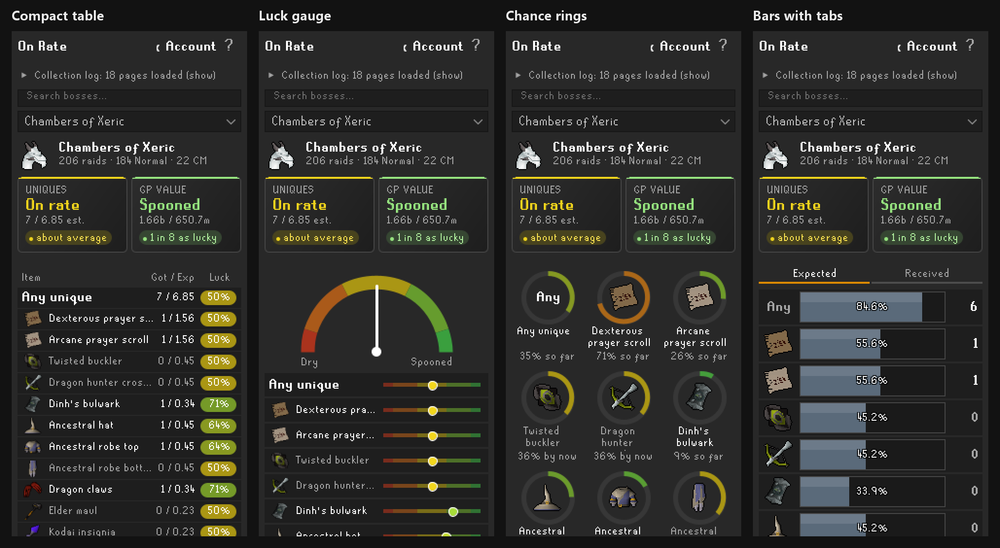

# How On Rate works

The details behind the [README](../README.md): every part of the panel, every setting, and the assumptions On Rate makes. Where each drop rate comes from is in [RATES.md](RATES.md).

## Reading the panel

Pick a boss from the dropdown, or let the panel follow your kills. To find a boss quickly, type in the search box above the dropdown: part of the name ("vork", "kril") or the usual short name ("cox", "tob", "toa", "dk"). From 3 letters it also finds bosses by the items they drop ("fang", "tassets"), shared items included: each typed word has to start a word of the same item name, and the open list says which item a boss matched ("Zulrah · Tanzanite fang +1"). Bosses found by name come first, then exact item names, then the rest alphabetically. Enter opens the first match. If nothing matches, the search box says so and the page you were on stays as it is. The **‹ Account** link next to the **?** takes you back to the account overview from a boss page. The **?** at the top right explains what you're looking at.

### Boss page

- At the top: the boss and your kill count, then two **verdict tiles** side by side. **Uniques** counts how many you got against how many you should have by now; **GP value** weighs them by their GE price, so a twisted bow counts for more than a prayer scroll. Each says Extremely dry, Very dry, Dry, A bit dry, On rate, A bit spooned, Spooned, Very spooned or Extremely spooned, with the numbers and how common your result is among players at the same kill count ("1 in 3 as dry" means about 1 in 3 players has this many or fewer; "74% have none" when you have none yet; "about average" when it says On rate). Under half a unique expected on a boss page, the tile says **Too early** instead of a verdict: a few kills can't tell dry from lucky. Hover a tile for it as a percentage ("drier than 67%": 67% of players have more than you; "luckier than 83%": 83% have fewer; far-out results add how rare they are, like "1 in 1,205") and for the full split: how many players have fewer, as many and more than you.
- **The line under the tiles:** a short fact about the page, in grey. There can be several (the driest item (more than 8 in 10 players have more), one you don't have that 6 in 10 players would have by now, the luckiest item (more than 8 in 10 have fewer), and facts about the page itself); click the line to show the next one ("Click for another fact"). A page that was just opened, or whose expected count changed after a kill, moves on to the next fact; any other redraw keeps the same one, so it doesn't flicker. A fact only states a result so far or an average: none says a drop is due. Left-out items don't count, and nothing shows when nothing stands out (or on a **Too early** page).
- **Last unique:** the account overview says how long ago your last unique was, from the drops On Rate saw itself (History). Item hovers show the fastest and longest it took between drops since you installed On Rate.
- **How the verdict is decided:** "Players" here means the drop-rate maths, not real accounts. Every kill is an independent roll, so On Rate compares you with the spread of results a typical player would have at your kill count (a binomial distribution, approximated by a Poisson one at these small rates). It uses no data from other players. Dry when fewer than 35% of players at your kill count have this many or fewer (Very dry: under 10%; Extremely dry: under 1%); Spooned when fewer than 35% have this many or more (Very spooned: under 10%; Extremely spooned: under 1%); otherwise it's in the middle, split in three by where you stand among players at your kill count (counted from the driest, with players who have exactly as many as you put as close to the middle as they allow): A bit dry from 35% to 45%, On rate from 45% to 55%, A bit spooned from 55% to 65%. A result right on a line takes the word nearer the middle, so exactly 1% is Very dry and exactly 99% is Very spooned. So the most common result is never called dry: with no drops at 0.43 expected, 65% of players have none either, and that's on rate. The GP tile needs RuneLite's price list; untradeables (pets, jars, Vorkath's head) count as 0 GP. The GP verdict is worked out by simulating 5,000 typical players (always the same ones, so it doesn't flicker), which leaves about 0.14 percentage points of noise at the 1% and 99% lines: a GP result within that of a line can get the word on the other side of it, Very dry instead of Extremely dry or the other way round. The Uniques verdict is exact.
- Then one row per item, with **Any unique** first. The bar's fill is how many you got (the legend reads "bar = got · line = expected"); the **white line** is how many you should have by now. Behind the line is dry, past it is spooned.
- **Add a drop you remember:** On Rate only sees drops from the time it runs, so a unique you got earlier has no known wait. If you know the kill count you got it at, right-click the item on the boss page (it has to be one you have) and choose **I got this at kill...** (the word follows the boss: raid, delve...). Type the kill count and press OK:
  - It goes into the boss's History without a date, and your dry streak counts from it. Your unique counts and expected stay as they are, and it doesn't show in Recent or Today.
  - Open **Items > Single drops** on the account overview to see how lucky or dry that single drop was. For a raid drop each raid in the wait counts at its own purple chance: from its points when On Rate counted them, from the settings for the raids before that.
  - With more than one copy it asks if this was your first one: its wait is then its kill count. The only copy in your log counts as your first.
  - On pages with several modes or bosses (Chambers normal or Challenge Mode, Tombs entry, normal or expert, Callisto or Artio...) you pick which one first, and the kill count is that one's own, as the game's chat shows it.
  - History can't list more copies of an item than the collection log shows. If you added one by mistake, right-click it in History and choose **Remove from History**, which also takes back the dry streak it set.
- **Hover an item** for its drop rate, your chance of having it by now, how many players have fewer, as many or more than you, for something you don't have yet how far past the drop rate you are ("2.1× the drop rate without one": players call 1× on rate, 2× dry and 3× real pain), how many kills give a 50% or 90% chance, and your **dry streak**: kills since your last copy and how many times the drop rate that is. If your last copy dropped before you installed On Rate, it says "at least".
- At the bottom: **▸ HISTORY**, folded away until you click it (On Rate remembers whether you left it open, also after RuneLite restarts; so do Personal bests and Points over time). It lists the kills On Rate saw on this boss, newest first (the last 500 per boss are kept, saved in RuneLite's own settings like everything else):
  - **Most bosses:** one line per unique: the kill count, the item and how many kills it took, coloured by how that compares with the drop rate ("33 kills (0.7x)"). "your first one" means it was your first ever; "8+ kills" means your previous copy dropped before On Rate, so only a minimum is known. Under it: how many uniques you got in those kills against how many you should have.
  - **Raids:** every raid, with its mode, your points and that raid's purple chance (or the team size and deaths for Theatre of Blood), and the purples in it. Under it: your average purple chance over the raids with points. A raid that holds one of your personal bests (see below) says **PB** at the end of its line.
  - **Show more:** History lists 10 rows. A link under them shows 50, then all the rows kept (**Show fewer** goes back to 10), and it starts at 10 again on every boss. At bosses that list one line per unique, a row is a unique, so the limit counts uniques, not kills.
- **Raid pages** have four more folded sections under History. They use the raids On Rate saw itself and the raids it read from Raid Data Tracker (see Settings): other raids from before you installed it, and raids loaded from the collection log, have no team size, points or time.
  - **Purple chance by setup:** which of your setups gets you the most purples an hour. A setup is what you chose for a raid: the team size and the mode (Chambers of Xeric, Theatre of Blood; at Chambers of Xeric the team size is the size the raid scaled to, and a scaled raid shows how many players were still in it at the end plus the extra scale, like **1+2** for one player in a raid scaled for three; raids from before On Rate counted the players say **Trio/scaled**, as it can't tell which they were), the team size and the raid level in steps of 50 (Tombs of Amascut), or the team size (The Fractured Archive). Each row has your average purple chance a raid, your average raid time and the two divided: your purple chance an hour. The game's own raid time is used, so banking and walking aren't in it. Rows are sorted by the hour figure, only your top 5 setups are listed, and the top one says **FASTEST PURPLES**. With **GP value** on in the settings, a second tab shows what your purples are worth an hour (GE prices, uniques only) and its top row says **MOST GP**: at Tombs of Amascut the quickest purples at a low raid level are mostly the cheaper ones, so the two tabs can disagree. **Setup**, **Team** and **Mode** (Tombs: **Raid level**) switch between grouping by both choices or by one. A row needs 5 timed raids for its hour figure; until then it comes after the setups that have one, greyed, with how many it has. The tags are facts about your own raids, not advice.
  - **Personal bests:** per mode and team size, your fastest raid and your most points (Theatre of Blood: how many raids you had without a death; The Fractured Archive: your biggest share). Hover a best for the raid it came from; at Tombs of Amascut the hover also has your highest raid level. A first raid is no record yet: History only says PB once a mode and team size has two raids or more.
  - **Raids left for the log:** (**RAIDS LEFT FOR THE LOG**) how many more raids it takes to have every unique you're missing, and the pet, at how you raid now: your latest raids On Rate saw, or the settings when there are none yet. **Missing** lists what you don't have, with each one's chance a raid in its hover. Under it, a small table gives the number of raids after which 50% and 90% of players at your chances would be done, for all the uniques together and with the pet, and an "in hours" row at your average raid time once you have enough timed raids. It is a forecast of averages, not a target and not a promise: a raid is not more likely to give you a unique because you are missing some. It asks you to open the raid's collection log page once first, so On Rate knows which uniques you have; it reads "You have every unique and the pet" when nothing is missing.
  - **Raids left for the log** (raids) and **Uniques forecast** (plain bosses): how many more raids or kills it takes until 50% and 90% of players at your chances would have every unique you're missing (and, apart, the pet). Each item is its own independent roll, so the chance to have one after *n* more is 1 - (1 - p)^n and the chances of several items multiply. Every kill is a fresh roll: what you already did doesn't change it, and it is a forecast, not a date a drop is owed. Items you left out of the count are not in it. Raids use your last raids' chances, else the settings; bosses use the chances shown on the page, and hours come from your average kill time when known. It shows only for about 35 plain bosses where this maths holds, and not for raid-like or special cases: combined pages (Dagannoth Kings, the Gauntlet...), Doom of Mokhaiotl and the Fortis Colosseum (chances change with level or wave), Vorkath (a guaranteed head), Royal Titans, Tempoross, Wintertodt, Moons of Peril and the God Wars and team bosses.
  - **Points over time:** your last 40 raids, every mode together (Chambers normal and Challenge Mode, Tombs entry, normal and expert...), one dot each in the order you did them, with a white line for the average of the last 10 raids and a purple diamond for a raid that gave you a unique (from History or Raid Data Tracker); hover a raid for its mode and, on a diamond, which unique. Switch between **Points** and **Purple chance**. Under it: your average over the last 20 raids and the 20 before that. Theatre of Blood and The Fractured Archive have no points, so there it shows purple chance only.
  - **Nex, Yama, the Hueycoatl, Corp and Zalcano:** every kill with the team size On Rate counted and your share. Under the History list a **Teams** row splits all the kills On Rate counted by team size (sizes of 6 and up together), plus **Earlier** for the kills from before it counted teams (your kill count minus the ones it saw). The hover says what each size counts as (a kill with 3 players counts as a third) and the total, "counts as X of N kills": the kill share Expected uniques are worked out from. Pets and drops each player rolls for aren't scaled. The team size is a count of players seen fighting with you (at Zalcano, players around you, bystanders included), and sharing a kill evenly is an assumption. Only numbers are kept, never player names. The counts are lifetime counts, while the History list keeps your last 500 kills.
  - **Royal Titans:** every kill with the titan you looted. **Doom of Mokhaiotl:** every delve with its level.
  - **Time:** under History, how long the kills took on average, from the game's own time message. Kills without a time message (before you installed On Rate, added by hand, or a boss that sends none) aren't counted, and neither are times of 0 or 24 hours and more. Hover it on a normal boss for the **fastest timed**, median, average and latest kill and how many kills were timed ("37 of 120"). That is the quickest of the kills in History, which keeps your last 500, so it is not a personal best: an older, faster kill may no longer be in it, and nothing filters a slow time from stepping away mid-fight. Nex, Yama, the Hueycoatl, Corp and Zalcano mix solo and team kills, and pages with several fights (Dagannoth Kings, Callisto and Artio...) mix those, so they keep the average only. Raids keep the average and point to **Personal bests** for the fastest raid per mode and team size. **Doom of Mokhaiotl** has a **Time · per level** row: hover it for each level's fastest, median and latest delve (the deep delves are one row, **8+**) and how many were timed.
  - **Remove from History:** right-click a unique here, or in the account's Recent tab, and choose *Remove from History* to take out that one entry (it asks first), for example a unique saved with the wrong date or boss. Only that entry goes from History, Recent and Last unique: your unique counts, kill count, expected and dry streak stay as they are, and the kill itself stays in History. Today and Last 7 days keep counting it until that day is more than two weeks old, because On Rate doesn't save which day it counted a unique on. A kill line with several uniques lets you pick which one.

### Account overview

What the panel opens on. It adds up every boss you have kills at. A boss with 0 kills is left out, even if some of its items are in your collection log from somewhere else (an occult necklace from a regular smoke devil, say):

- **Back:** on the account overview, **‹ Back** sits where **‹ Account** is on a boss page and takes you back to the boss you were on. The overview also remembers which page you had open (the tab, the Sort order, the Items list and the Time page's list), even after you restart RuneLite.
- The two **verdict tiles** at the top are your whole account: **Uniques** (how many) and **GP value** (what they're worth). An account that's dry on the number of drops but hit two twisted bows shows up as spooned on GP value. Hover a tile for the details. Prices come from RuneLite's own price list, so On Rate makes no web requests; untradeable items count as what they make where the wiki says (see [RATES.md](RATES.md#gp-value-of-untradeable-uniques)); pets and most jars count as 0 GP. Turn off *GP value* in the settings to keep only the Uniques tile. The tiles stay at the top on every tab.
- Three tabs: **Bosses**, **Items** and **Recent**.
- **Bosses** (the default tab): one row per boss with its verdict. Use **Sort** to put the most expected, driest, luckiest, luckiest by GP value or longest dry streak first. **Luckiest by GP value** orders the bosses by their GP value verdict (what their uniques are worth against what they should be worth) and shows that verdict, word and dot, on each row, so a boss with two twisted bows reads as spooned even if its unique count is dry; the hover adds a *By value* line. It is only offered while the *GP value* setting is on, and bosses with nothing of value expected (pet-only bosses) come last. **Longest dry streak** shows, instead of the verdict, how long since each boss's last unique in times its unique rate ("2.6×"); a "+" means the last one came before On Rate, so it's at least that. Click a boss to open it, or hover it to see its driest item. Bosses with almost nothing expected yet (under 0.05 uniques) aren't listed, because they say nothing about luck; they still count in your account total.
- **Items:** your **driest** and your **luckiest** items across every boss, on one page: the top 5 of each, and click "top 5 of 17" to show the whole list (and again to fold it back). **Pets** shows the 5 luckiest pets you have (got with the fewest kills expected) and the 5 you'd most likely have by now but don't, and each group has a "top 5 of N · show all" link when it has more. Driest only lists items that are below average with at least 1 expected, so rare items you've barely farmed don't fill it up; Luckiest only needs one drop and above-average luck. On the Items page each row also says **got / expected** beside the dot (for example `0 / 2.60`): how many you have, against the average number a player would have by now. That is a statistical average, not a number you were owed, so `0 / 2.60` means none, where the average player would have about 2.6. The verdict word and the dot say how dry or lucky that is, and the hover has the full explanation. Click one to open its boss.
- **Items > Single drops:** your single drops, each judged once by how long it took against its drop rate. **Luckiest single drops** are the ones that came soonest, **Longest waits** the ones that took longest, plus items you are still waiting for (marked "waiting"). Each row has the item, its boss and kill count, and how lucky the wait was ("1 in 34 players this quick"). Only the top 5 of each list show; click "top 5 of 17" to show the whole list, and again to fold it back. Drops you add yourself (see *Add a drop you remember* below) are in these lists too.
- **Recent:** first **Today** and **Last 7 days**: your kills and uniques, in total and per boss. The number of uniques is coloured, with a small triangle (up for more, down for fewer), when it's clearly more or fewer than you should have had from those kills (outside the middle band of the verdict scale, with no "too early" limit, so a day with little expected can show it); hover a line for the expected number. On Rate keeps these counts for two weeks, so they are always complete, however many kills you do. Below that, your 10 latest uniques across every boss: the item, the boss and kill count, when ("today", "3 days ago") and how many kills it took. Click one to open its boss. Today, Last 7 days and the latest uniques only hold drops On Rate saw happen (Loot Tracker, chat messages). A copy it only finds when you open the collection log still counts in your totals, but isn't listed here, because the log doesn't say when or where you got it. That includes repeat Gauntlet seeds and repeat Obor and Bryophyta chest drops, which On Rate only learns about from their log pages.
- One grey line under the bosses says how many bosses aren't listed (hover it to see which). **Shared items** (dragon pickaxe, godsword shards, Virtus, onyx...) have no row here: you find them on the page of each boss that drops them. They do count in the account's **verdict** and **GP value** at the top, once On Rate knows the kill count of every boss that drops them.

### The Time page

The Items tab's **Time** page shows how long, on average, the items you don't have take to get: the time of a kill (or raid, chest or Doom delve) divided by your chance of the item in it.

- **The list:** a dropdown picks it. **Items** (quickest first), **Ladlor's chart** (the chart's items in the chart's order, quest-gated ones included, each with the time for all the drops it needs), **Pets** and **Raids**. Items you have are left out, and so are the items of Slayer bosses above your Slayer level (it uses your real level, remembered per account; until it is known, every Slayer boss is hidden).
- **The chance:** for raids it comes from your points. For Doom it comes from the delve levels you really did (each level has its own rates and time, and the loot of a run is only kept if you claim it).
- **Ladlor's chart list:** it also says how long everything left on the chart takes together, and each row its step and where to farm it.
- **How long the grind is:** a thin bar under each row (each step is ten times longer; full is 1,000 hours).
- **Where the time comes from:** a chip on every row. **yours** is the average of your own timed kills (from 5 timed raids or 20 timed kills; for Doom, each delve level from its first timed delve). **wiki** (marked **~**) is the OSRS Wiki's money-making guides, bundled with the plugin, nothing is fetched; they assume strong gear and stats, so most players are slower. **mixed** is both. Bosses the wiki has no figure for show no time until you have your own.
- **Wiki guide link:** a row whose time is (partly) the wiki's names the OSRS Wiki guide the rate comes from in its hover, and right-clicking the row offers **Open the wiki guide** (one entry per guide when a time blends several; left click still opens the boss page). The link opens in your browser only when you pick it; nothing is fetched, and the title is not checked against the live wiki, so a renamed page can land on the wiki's search. It names the source of the rate, not a pace to reach. Rows with only your own times, Doom and the Ladlor chart have no guide.
- **Your own times** are the game's fight times, so banking and walking aren't in them. They are read from the game's own time message: *Fight duration*, the Chambers raid time, the Tombs total time, the Gauntlet, Tempoross and Doom delve times and more. Kills from before On Rate saw a time, and bosses whose kills have no time message, have no time.
- **Oathplate:** hover Yama's Oathplate pieces, or the Oathplate chart item, to see the oathplate shard route (about 0.81 shards a kill, 450 plus 2,520 crushed infernal shale per piece) and the time it saves.
- **Item hovers** anywhere (a boss page, the Items tab) also say how long one copy takes on average and where that time comes from.
- **Raid Data Tracker:** if you also use the **Raid Data Tracker** plugin, On Rate reads your Chambers of Xeric and Tombs of Amascut raids from its saved files (read only; the setting is **Import raids from Raid Data Tracker** under Raids), so your raids use your own times straight away. Nothing is read until you pick Raid Data Tracker's folder with **Choose Raid Data Tracker folder** (the same place); the choice is not saved, so it has to be made again each time RuneLite starts, and it is read for the account that is logged in. A line under the raid sections on the Chambers of Xeric and Tombs of Amascut pages says which of three states you are in: the import is off, it is on but the folder has not been chosen yet, or the folder was chosen this session. It also takes each raid's points, team size and raid level. **Chambers of Xeric** raids are saved like ones On Rate saw itself: such a raid then uses its own purple chance instead of the average from the settings, and it shows in the raid sections (purple chance by setup, personal bests, points over time). They are matched by mode and completion count: one On Rate already has keeps its own record, and within a mode a completion count that goes down while the date goes up is skipped. **Tombs of Amascut** raids only show in the raid sections and don't change your luck numbers: in those files a Tombs raid's completion count doesn't reliably follow its mode, so it can't be placed among your raids. They are matched to your own raids by date (within 10 minutes), kept in memory, read again once the folder is chosen, and their hover shows the date instead of a raid number. Your unique from each raid (only when it was yours, not a teammate's) is used to name the purple on the points graph; it isn't added to History. Tombs of Amascut points are On Rate's and Raid Data Tracker's shared estimate, without the points the whole party earns once (puzzle rooms), so those raids can count a little low. Turning the setting off stops new imports; raids already imported stay. Theatre of Blood raids are not imported. Nothing is imported on Leagues, Deadman or other seasonal worlds: Raid Data Tracker's files don't say which world type a raid was on, so they would bring in your main game's raids.
- **Oathplate:** hover Yama's Oathplate pieces, or the Oathplate chart item, to see the oathplate shard route (about 0.81 shards a kill, 450 plus 2,520 crushed infernal shale per piece) and the time it saves.
- **Item hovers** anywhere (a boss page, the Items tab) also say how long one copy takes on average and where that time comes from.

### Other views

Prefer something else than the bars? Pick another **Item view** in the settings under **Display**. The boss pages, the account overview and the Items tab all use it:

- **Target bars** (default): described above.
- **Compact table:** one line per item: got / expected and a luck chip: the share of players who got fewer than you, counting half of those who got exactly as many (tie-aware), in its luck colour. Below 50% it is the share as dry or drier, so a bare "33%" is not a score out of 100. Hover a line for it in words ("drier than 67% of players (1 in 3 as dry)"): the same fact from the other side, with the wording of the verdict tile.
- **Bars with tabs (Delve Calculator):** the classic Expected and Received tabs. On *Expected* the number is how many you should have and the bar how close that is to the next whole one ("Any · 41.8% · 4" means 4.418 uniques by now); on *Received* the number is how many you got and the bar how lucky that is.
- **Chance rings:** each ring fills as the chance of having the item by now grows. Once you have it, the ring shows the chance of having had another since your last (written "40% so far").
- **Luck gauge:** a speedometer from dry to spooned, with every item (or boss) as a dot on the same scale.

### Extras

The trip card is on by default. Change it in the settings under **Display**. Luck over time opens and closes from the panel itself.

- **"Too early" has two cut-offs.** A boss page says it under 0.5 of a unique expected. The trip card is shorter by nature, so they say it under 0.05, and show a verdict from there on (a trip with 0.3 expected shows a verdict, the same boss page would still say "Too early"). In lists, a row with nothing received and under 0.5 expected is drawn quietly, and the overview's boss list leaves out bosses with nothing received and under 0.05 expected.
- **Luck over time:** your account's luck over time, one point per day you play, in the account overview. Click its title to open or close it; it stays the way you left it. Each point is your whole account's cumulative luck at the end of that day, so the line is not recent form. Once you have more than 30 days of points, a **30 days | 90 days | All** row zooms in on the latest days (the line starts where it stood and stays flat on days you didn't play). It shows the same cumulative line, not the luck of those days alone, and the choice is not saved: it is All again after a restart. On Rate saves a point every day even while it's closed, so it has data when you open it.
- **This trip card:** kills, uniques and expected for your current trip on the boss page, plus kills per hour, the drops you got and what the uniques should be worth per hour at that speed ("Unique value: ~1.2m/h expected"). That value only counts uniques, not normal loot like bones or hides. A trip ends when you kill another boss, after 30 minutes without a kill (2 hours for raids, the Inferno and the Fight Caves, where one run can take longer), or with the *Start a new trip* button.
- **Recent tab layout:** two tiles (Today, Last 7 days) with a switch under them: **Uniques**, **By boss** and **Trips** show one list at a time. The descriptions of those lists in this document apply to the matching page.
- **Trips this session:** on the Recent tab's **Trips** page (it was listed under Today and Last 7 days): your last five finished trips (3 or more kills), newest first. A trip is finished when another boss is killed, after its idle limit (the same as above), or with *Start a new trip*; one left idle past its limit shows without waiting for the next kill. Each row says kills, uniques, when, how long and a verdict. Under half an expected unique (the same rule as the boss page) the verdict is **Too early**, with no colour or percentage, because a few kills can't tell dry from lucky. The list is not saved: it is empty again after RuneLite restarts or when you switch account, and resetting a boss removes its trips. Today and Last 7 days are saved.
- **Luck colours:** the colours for dry to spooned. **Classic** is red, yellow, green; **Colour-blind** is orange, grey, blue; there are also purple to amber, pink to grey and mono sets, and **Custom** lets you pick your own dry and on rate colours (spooned stays green). It replaces the old **Colour-blind colours** tick: if you had that on, it carried over as the Colour-blind set.
- **Custom luck colours:** the colours you pick are used as they are in bars, rings and dots. Text in a luck colour (verdict words, tiles, tooltips) is lifted towards white only as far as needed to reach a 4.5:1 contrast on the panel's dark cards, so a dark pick stays readable. The ready-made sets are not changed.

### Log forecast

Under History, behind the same switch as the raid sections (Raid extras), a folded **UNIQUES FORECAST** table says how many more kills it takes for 50% and 90% of players, at the chances On Rate uses, to have every unique you're missing. Raids keep their own **RAIDS LEFT FOR THE LOG** table.

- **The maths:** each missing item is an independent roll at its chance, and every kill is a fresh roll, so kills you already did change nothing. After n kills an item is done with chance 1 - (1 - p)^n, and the table finds the n where all of them are done together. No pity or bad-luck protection is modelled. Hours show only when a kill time is known.
- **What is not counted:** items you already have; items other bosses drop too (they are judged together under *Shared with other bosses*, not in the table); a guaranteed drop (Vorkath's head, guaranteed at kill 50, is named under the table and left out, so only the real rolls are forecast). The pet is shown apart, as "With the pet".
- **Skipped bosses:** raids (own table); Fortis Colosseum (the chance changes with the wave), from the boss data; Moons of Peril (duplicate protection is not modelled) and Wintertodt (one row stands for four outfit pieces and its units are reward rolls), both marked `"logForecast": false` in `bosses.json`; and a boss with no rows of its own (Chaos Elemental). A new boss gets the table without a list edit unless it is one of these.
- **Doom of Mokhaiotl** is in, at the delve levels you have done so far: each item's chance a delve is the average of its per-level chances over your delves (the same average the page uses), and hours use the same time per delve as the Time page: each level at your own average from its first timed delve, else the wiki time. With no delves seen it shows a note. Delving deeper raises the chances, and a note says so.
- **Team and estimate bosses** (Nex, Yama, Corporeal Beast, Zalcano, the God Wars bosses, Royal Titans, Barrows, Brutus, Tempoross and the rest) get the table with a note: the chances use your average share or estimate so far, the same share logic as the page's numbers (`Statistics.sharedKills`).
- **Combined pages** (Dagannoth Kings, Callisto and Artio, The Gauntlet, Venenatis and Spindel, Vet'ion and Calvar'ion) are not blended: each part has its own small table with its own kill count and rates. A part with no kills yet shows a note instead. The one-line "rest of the log" sentence under the verdict follows the same rule: it appears only where the table does, and not on combined pages.

## Supported bosses

On Rate covers these bosses and raids from the **Bosses** and **Raids** tabs of the collection log (what it leaves out is under [Good to know](#good-to-know)):

Abyssal Sire, Alchemical Hydra, Amoxliatl, Araxxor, Barrows, Brutus, Bryophyta, Callisto and Artio, Cerberus, Chambers of Xeric, Chaos Fanatic, Commander Zilyana, Corporeal Beast, Crazy Archaeologist, Dagannoth Kings, Deranged Archaeologist, Doom of Mokhaiotl, Duke Sucellus, Fortis Colosseum, General Graardor, Giant Mole, Grotesque Guardians, Hespori, Hueycoatl, K'ril Tsutsaroth, Kalphite Queen, King Black Dragon, Kraken, Kree'arra, Maggot King, Moons of Peril, Nex, Obor, Phantom Muspah, Phosani's Nightmare, Royal Titans, Sarachnis, Scorpia, Scurrius, Shellbane Gryphon, Skotizo, Tempoross, The Fractured Archive, The Gauntlet, The Leviathan, The Mad Angel, The Whisperer, Theatre of Blood, Thermonuclear Smoke Devil, Tombs of Amascut, TzKal-Zuk, TzTok-Jad, Vardorvis, Venenatis and Spindel, Vet'ion and Calvar'ion, Vorkath, Wintertodt, Yama, Zalcano and Zulrah.

Bosses that share a collection log page are shown together, just like in the log: **Dagannoth Kings**, **Callisto and Artio**, **Vet'ion and Calvar'ion**, **Venenatis and Spindel**, and **The Gauntlet** (normal and Corrupted). Each boss on the page keeps its own kill count and drop rates.

**Chaos Elemental** has a page but no verdict of its own (it says *All shared*): none of its uniques are exclusive to it. The dragon pickaxe and a pet it shares with Chaos Fanatic are judged on all the bosses that drop them, under **Shared with other bosses**, and its kill count counts there (see [Good to know](#good-to-know)). The dragon 2h sword is judged the same way: it also drops from Kalphite Queen, Callisto, Artio, Vet'ion, Calvar'ion, Venenatis, Spindel and Scorpia.

**God Wars Dungeon** generals assume you kill all three bodyguards every kill. The bodyguards roll some of the general's uniques (1/16,256 for each Bandos piece, 1/16,129 for each Armadyl piece, 3/16,129 for the Saradomin sword and Zamorakian spear, 1/1,524 for each godsword shard), and the collection log counts those under the general. Bodyguard loot counts for the general but not as a kill.

**Maggot King**: the pet can also come from taking eggs, which On Rate can't count, so its pet row is a low estimate.

**Barrows** assumes you kill all six brothers before every chest, and **Moons of Peril** assumes you defeat all three moons before opening the Lunar Chest.

## Settings

Open the settings with the cog next to **On Rate** in the Configuration panel.

- **Follow last kill:** switch the panel to the boss you just killed. On by default.
- **Items tab:** the Items tab on the account overview (your driest and luckiest items, pets, single drops and the Time page: how long the items you don't have take). Turning it off hides all of these, including the Time page and the Ladlor chart. On by default.
- **GP value:** the GP value tile (see [Account overview](#account-overview)). On by default.
- **Trip card** and **Luck colours**: see [Extras](#extras). **Luck graph** is the same open or closed choice as the title of Luck over time. The trip card is on by default.
- **Count your team:** at Nex, Yama, the Hueycoatl, the Corporeal Beast and Zalcano, On Rate counts the players within 15 tiles of you at each kill and gives you that share of the kill: a quarter with four players, a half in a duo. The boss's page says how many kills it saw and the average team size. Kills from before On Rate counted use the team of the first kill it counted (Yama uses its own setting below), and the pet chance doesn't scale (except at Corp, where only the top damager gets loot). At Zalcano only the crystal tool seed is shared; shards and the pet are rolled for each player. On by default.
- **Royal Titans: how you kill them:** kills count as **duo** kills unless you change it to **Solo** or **Some of each**. With *Some of each*, also enter how many of your kills were solo; the rest count as duo. In a duo you get about half the uniques of a solo kill, while the pet chance stays the same.
- **Yama: earlier kills:** how you killed Yama before On Rate could count your team: **duo** by default, or **Solo** or **Some of each** (with your number of solo kills). Kills from then on use the counted team size.
- **Use raid points:** at the end of each raid, On Rate saves your points with the completion and works out that raid's purple chance from them. On by default. How it gets the points:
  - **Chambers of Xeric:** read straight from the game when "Congratulations - your raid is complete!" appears: your points, the team's points and the team size.
  - **Tombs of Amascut:** at the end of each raid the game sends your exact points, and On Rate uses those (the same number the Tombs of Amascut plugin reads). Only if they don't come does it fall back to its own estimate, the way [Raid Data Tracker](https://runelite.net/plugin-hub/show/raid-data-tracker) and the Tombs of Amascut plugin do: your own hits times a points factor per monster, rooms capped at 20,000 (Crondis 10,000), 64,000 in total, Wardens phase 2 stops counting once it has been downed more than three times, fixed points for puzzle rooms, 300 per player for MVP items, and minus 20% (at least 1,000) per death. The raid level is read from the game. In a team On Rate only knows your own points; if you have the **Tombs of Amascut** plugin installed, its party total is used instead. Without the exact points On Rate needs to see the raid start, so a raid you were already in when you turned it on uses the setting.
  - **Theatre of Blood:** there are no points to read. On Rate saves the team size, your deaths and whether you were MVP from the board at the end, and splits the team purple chance from the settings over that raid's real team size.
  - **The Fractured Archive:** the game doesn't show your contribution, so On Rate estimates it from the damage it sees: in each fight it adds up your hits and your teammates' hits on that room's monsters (boss and minions, by their NPC IDs from the OSRS Wiki), and gives you that share of the room's 100 contribution (Ocellus: 300 over all his phases). It also counts your deaths, and counts the players around you when "Your The Fractured Archive completion count is" appears (with **Count your team** on). If it missed one of the five fights (turned on mid-raid, say), that raid assumes an even share and no deaths. Not modelled, because Jagex hasn't published them: the soft cap on minion damage and how Ocellus's 300 is split between his phases.

  The chance is worked out with the OSRS Wiki's formulas. **CoX:** every 8,676 team points is 1% for a unique, one roll is capped at 570,000 points (65.7%) and more points roll for another unique; you get a unique with your share of the points. **ToA:** 1% per 10,500 - 20 x raid level team points (the raid level counts fully up to 310, a third from 310 to 430 and a sixth above that), capped at 55%; at low raid levels some uniques are rare: below raid level 50 for Osmumten's fang and Lightbearer, below 150 for the shadow, ward and Masori. When the chest picks one of those, you only get it 1 time in 50; otherwise you get normal loot instead. **The Fractured Archive** (from Jagex's loot post): every room hands out 100 contribution (Ocellus 300), 700 in all, split by damage. Since the game update of 11 November 2026 the team's chance is fixed per raid size: 1 in 16 for a solo or duo, 1 in 12.5 for three players, 10.5 for four, 9.5 for five, 8.5 for six, 8 for seven and 7.5 for eight, and the unique goes to a player with their share of the contribution. A death takes 10% of your expected contribution (35 of a duo's 350). Together that makes your chance the team's chance x your contribution / 700: 1 in 32 each in an even duo. On Rate reads "assuming no deaths" as deaths shrinking the team's chance too, so a teammate's death doesn't change yours. Raids On Rate saved before that update keep the chance they had then: 1 in 14 for a solo or duo, plus 4% of that per player beyond two (x1.04 for three, x1.12 for five, x1.24 for eight). The pet (1/750), the folio (1/15) and the elemental fragments (1/14, never a repeat until you have all four; 1/20 before that update, though On Rate counts every completion at 1/14) roll for everyone, whatever the contribution, so they count every completion at their own rate. The same update made defence-reducing special attacks and freezing or stunning Xarth's zombies give contribution; On Rate only sees damage, so its estimate reads a little low if you do those.

  Raids done before this update and raids synced from the collection log use the percentages below (Theatre of Blood with the **Theatre of Blood team size** setting). The raid's page says how many raids used your points. Over time, more and more of your raids use their own points.
- **Theatre of Blood team size** (under Raids): how many players you usually do Theatre of Blood with (4 by default). Your share of the team's purples is 1 / team size. Raids where On Rate read the end-of-raid board use their real team size.
- **Fractured Archive team size** (under Raids): how many players you usually do The Fractured Archive with (2 by default, up to 8), for raids where On Rate didn't count your team. Bigger teams get their own, higher team chance, and you an even share.
- **Raid purple chances** (folded away; most players can leave these alone): your chance of a unique per raid depends on your points, team and mode, so every mode has its own setting, named after the raid and mode (for example **Chambers of Xeric purple chance, Normal (%)**, **Theatre of Blood team purple chance, Hard Mode (%)**, **Tombs of Amascut purple chance, Expert Mode (%)**, **Fractured Archive team purple chance (%)**). The two team sizes sit under Raids, not in this folded section. The panel counts each mode's completions separately.

  | Raid | Mode | Default | How to work it out |
  |---|---|---|---|
  | Chambers of Xeric | Normal | 3.5% | Every 8,676 of your personal points is 1% (30,000 points is about 3.5%) |
  | Chambers of Xeric | Challenge Mode | 6.6% | Same formula; a Challenge Mode raid is usually 6.3 to 6.9%. It uses its own unique table (prayer scrolls are rarer) |
  | Theatre of Blood | Normal | 11% for the team | A team gets a purple about 1 in 9.1 raids. On Rate splits it over the **Theatre of Blood team size** setting (4 by default), or over the real team size when it read the end-of-raid board |
  | Theatre of Blood | Hard Mode | 13% for the team | About 1 in 7.7 raids, split the same way |
  | Theatre of Blood | Entry Mode | 0% | Entry Mode has no uniques |
  | Tombs of Amascut | Entry Mode | 0.75% | At low raid levels most rolled uniques turn into other loot |
  | Tombs of Amascut | Normal | 2.5% | Depends on raid level and points; the OSRS Wiki has a calculator |
  | Tombs of Amascut | Expert Mode | 5% | Same as above |
  | The Fractured Archive | | 6.25% for a duo team | 1 in 16 for a solo or duo with no deaths. On Rate works out the bigger teams' own chances from it and gives you an even share for the **Fractured Archive team size**, or for the team it counted. Every raid since the game update of 11 November 2026 uses it, so change it if Jagex changes the rate again; raids from before that update keep 1 in 14 |

## Good to know

- **Rates are solo / full-contribution base rates**, without diary, Combat Achievement or Slayer task boosts. At Nex, Yama, the Hueycoatl, Corp and Zalcano, On Rate counts your team from the players who hit the boss with you (at Zalcano, the players around you; see [Settings](#settings)); it assumes everyone does the same damage, so a carry or a leech is off. Royal Titans and Yama count as duo kills by default, and each has its own solo/duo setting. Where every rate comes from, and when it was last checked against the wiki, is in [RATES.md](RATES.md).
- **Leave an item out:** right-click an item on a boss page and choose *Leave out of the calculations*, for a drop you got somewhere else (an Araxyte head from araxytes, an Occult necklace from a regular smoke devil, a Hydra's eye from hydras, a Kraken tentacle from cave krakens) or items you don't care about (jars, crystal weapon seeds). It no longer counts for that boss's verdicts, the account overview, the Items tab or dry messages, and moves to a greyed *Left out* list at the bottom of the page. Right-click it there to count it again. Items that also drop elsewhere say so when you hover them.
- **Items several bosses drop are counted together**: the dragon pickaxe, godsword shards, Virtus, chromium ingots, draconic visage, dragon axe (Dagannoth Kings and Wintertodt), uncut onyx, dragon chainbody and the Chaos Elemental pet. The collection log has one total for all their bosses, so On Rate can't tell which boss each copy came from. Instead of guessing, every boss that drops one shows it under **Shared with other bosses**, judged on all those bosses' kills together against the one log total: the same numbers on each of those pages. **Judge one per boss:** if you know where yours came from, right-click a shared item. With no older copies, choose **Move it to each boss separately**. The copies On Rate saw drop count for the boss that dropped them. For the older ones it didn't see (from before On Rate, or before this option existed), you say where they came from: **Move my older one to** (one copy) or **Move all N older ones to** (several), then pick the boss, or **Split my N older ones between bosses...** to give a number per boss. Only bosses you have kills at are offered. For the dragon chainbody, draconic visage and uncut onyx you can also pick **Not from a boss** in that list (devils, regular dragons and wyverns, Zalcano or the Fortis Colosseum): those copies count for no boss, so they no longer make a boss look luckier. From then on On Rate notes those items from other monsters as not from a boss by itself, as long as RuneLite's Loot Tracker reports the drop. The item then becomes a normal row on each boss's page and counts in that boss's Uniques and GP value verdicts, judged on that boss's kills alone; it has no dry streak, because On Rate doesn't know when the older copies dropped. Your account totals stay the same, except that copies not from a boss no longer count. If your log later shows a copy On Rate didn't see drop (played on another client), the item is judged with the other bosses again until you answer once more. Right-click the row and choose **Move it back to Shared with other bosses** to undo. The dragon chainbody, draconic visage and uncut onyx also drop outside those bosses (devils, other dragons, Zalcano and the Fortis Colosseum) and the log counts those too, so they can look luckier than they are; their hover says so. They can't be left out. Bosses whose kills On Rate doesn't know yet count as 0 until you open their log page, and the page says which. The Alchemical Hydra's **dragon thrownaxes** and **dragon knives** are left out completely, because they also drop from monsters outside the bosses (thrownaxes and knives from wyrms, drakes and hydras). The collection log doesn't say where a copy came from, so On Rate doesn't count these even when the boss really dropped them.
- **Gauntlet loot** goes to a chest the Loot Tracker doesn't see. On Rate notices new items through the collection log message; open The Gauntlet's collection log page after a session to update repeat seeds.
- **Pets** are counted from the "funny feeling" message right after a kill. Like the collection log, On Rate counts a pet once: for luck, what matters is whether you have it by now, not how many duplicates you might have rolled. Royal Titans prayer scrolls work the same way, because they stop dropping once read. You loot one titan per kill and each scroll only drops from its own titan (1/75), so On Rate assumes you loot both equally: 1/150 per scroll per kill, 1/300 in a duo.
- **Not covered:** the team version of The Nightmare, and the collection log's Other tab (Slayer monsters like Tormented Demons and demonic gorillas are there). Fortis Colosseum, Tempoross and Wintertodt are covered; [RATES.md](RATES.md) says how their runs and reward rolls are counted.
- **Chest bosses:** Obor's and Bryophyta's uniques come from their chests, which the Loot Tracker doesn't see. New items show up through the collection log message; open their collection log pages to update repeat drops. Repeats found that way (here and at The Gauntlet) update your counts and dry streak, but don't show in Recent, because the log doesn't say when you got them.
- **Files:** On Rate uses the rates built into the plugin and saves your progress in RuneLite's own settings. The only files it touches are Raid Data Tracker's, which it reads (if that import is on) but never writes.
- **Made a mistake?** The small **Reset this boss…** link at the bottom of a boss page clears that boss (it asks first, with Cancel as the default). Opening its collection log page again brings back the kill count and item counts. History, raid points, counted team sizes, dry streaks, fastest and longest gaps, drops you added by hand, Doom levels and Colosseum claims are gone for good.

## Running from source

Open the project in IntelliJ IDEA (Java 11 or newer) and run **Tasks → application → run** in the Gradle tool window. To log in with a Jagex account in that window, start RuneLite once through the Jagex Launcher with `--insecure-write-credentials` set in *RuneLite (configure) → Client arguments*. `gradlew test` runs the tests.
